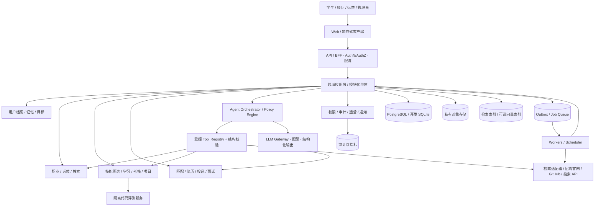
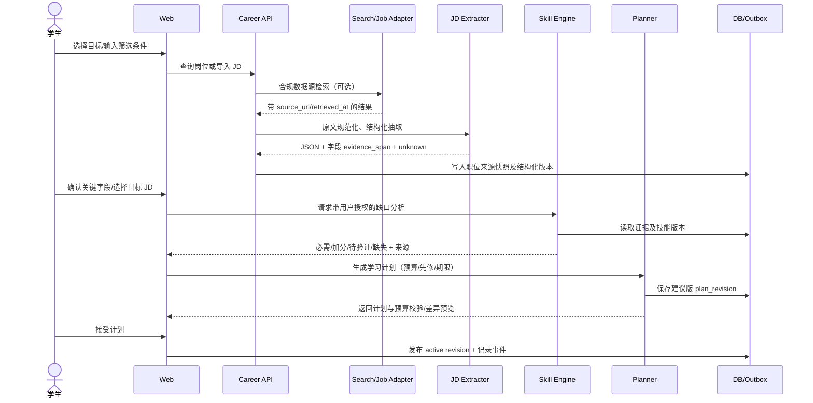
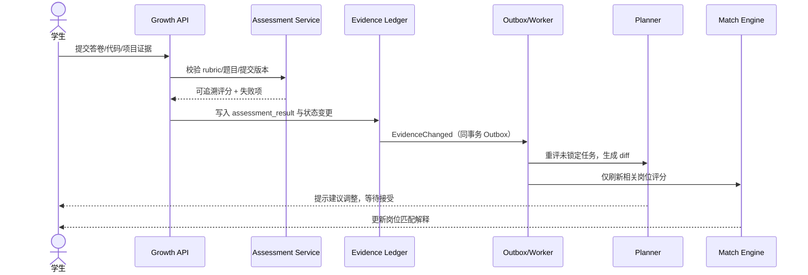
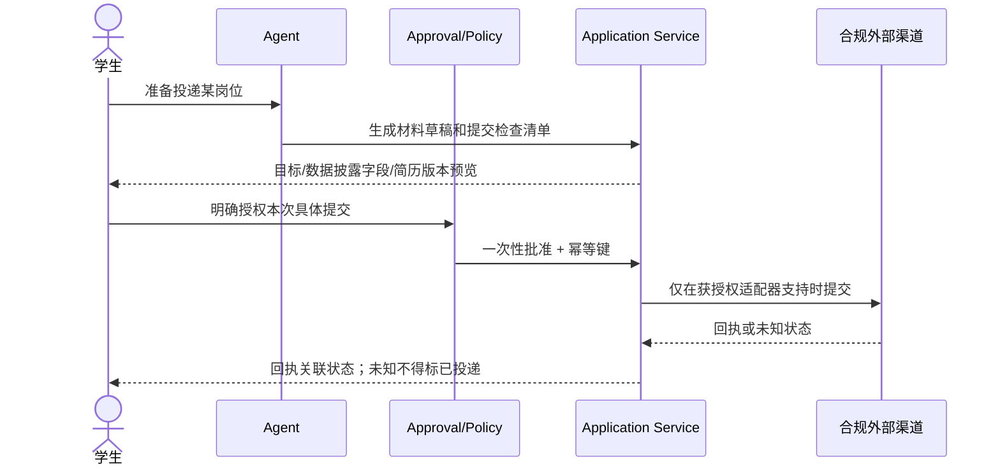
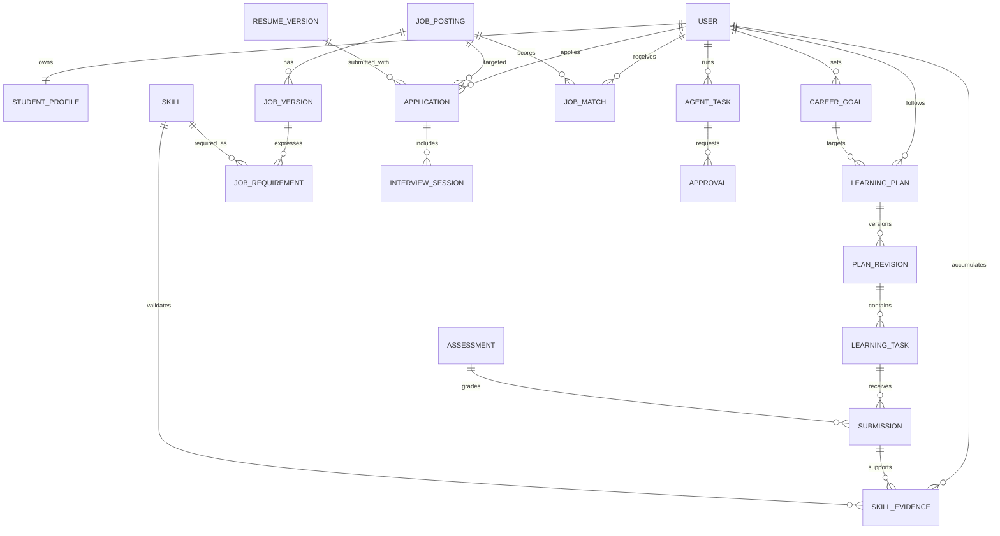

# CareerPilot — 系统架构设计（ARCHITECTURE）

> **文档版本**：v1.2 · 2026-10-23  
> **状态**：完整产品目标架构；V0 本地实施与技术验证见 docs/V0-EXIT.md，生产和后续业务仍待各阶段验证  
> **产品输入**：[`PRD.md`](./PRD.md) v1.0（110 条 `FR-*`、18 条 `NFR-*`、18 条 `E2E-*`）；源文件 SHA-256：`09a37e400ad9fc165e6624fa2c4bf14de5cbe645a6f79ebeabb3be0138df3b1d`  
> **研发落地**：[`TASKS.md`](./TASKS.md)；需求编号保持 PRD 原样。  
> **架构原则**：这是完整产品的目标架构与分阶段演进设计，**不是仅面向 MVP 的临时方案**。标记为“建议”的选型需经技术验证才进入正式 ADR。

---

## 1. 架构目标、范围与约束

CareerPilot 将大学生的职业探索、真实岗位情报、技能能力证据、学习训练与实习/校招全过程，构成可审计的闭环：

`职业目标 → 合规岗位/JD → 结构化技能要求 → 证据化能力缺口 → 学习任务 → 考核/项目成果 → 能力版本更新 → 匹配/学习重评 → 简历/面试/投递反馈`。

**设计优先级**：正确性、隐私与可解释性 > 安全的自动化 > 可运维性 > 模型复杂度。任何跨模块自动化必须有来源和状态记录；用户「完成课程」不能被误写为「技能已验证」，「生成投递草稿」不能被误写为「投递成功」。

约束与假设：

- 首批行业：计算机/AI，领域模型不写死计算机行业；主要中文与中国大陆求职场景，时区、地区和多语言可扩展。
- **以 MyCareer 作为候选复用底座**，而不是已确定依赖。V0 对其许可证、前后端接口、扩展点、存储格式及安全进行审计；不通过即采用自建模块并保持同样的领域接口。
- 单用户开发形态可先采用 SQLite，但 **用户级资源所有权和权限从第一天设计**；多用户线上正式版默认 PostgreSQL。
- 官方招聘渠道、经授权的 API、合规索引或用户主动提交 JD；不设计反爬绕过、偷取 Cookie、无授权自动投递。社交平台接入遵守 PRD §7.3。
- LLM 仅提供语义能力和可审阅草稿；身份/权限、状态机、硬约束、预算和确认必须由确定性代码实现。
- 本文中的分数、超时、扩容参数为**建议起点**，不可当作已上线 SLO 或性能实测。

### 1.1 架构质量属性与优先序

| 属性 | 设计策略 | PRD 对应 |
| --- | --- | --- |
| 可信任 | 来源快照、证据等级、结构化字段的原文跨度、不可篡改版本链 | FR-JOB-003、FR-SKL-002、NFR-010 |
| 安全隔离 | 对象级鉴权、最小权限、外部输入不可信、独立代码沙箱 | NFR-006/007/018 |
| 可恢复 | 幂等键、事务性 Outbox、任务状态机、可补偿步骤 | FR-AGT-004、NFR-004/005 |
| 可演进 | 模块化单体 + 端口适配器、可选拆分 Worker/服务 | V0–V4 |
| 成本可控 | 模型网关配额、缓存、离线批处理、调用追踪 | NFR-013 |
| 合规可控 | 每源接入策略、有效授权、明确用户确认、内容保留策略 | FR-SRC-005、FR-APP-005/007 |
| 可测试 | 合同测试、确定性规则测试、金标集、E2E 回归 | NFR-012、PRD §14 |

---

## 2. 总体架构与部署演进

### 2.1 逻辑组件图



**建议采用模块化单体（modular monolith）作为早期产品主形态**：单代码仓库、单后端可部署单元、严格模块边界、应用层服务通过契约交互。岗位采集、LLM 重任务、通知及代码评测由独立 Worker 执行。V4 有真实瓶颈后再按模块拆分，不以「六个 Agent = 六个微服务」为目标。

### 2.2 环境拓扑与阶段差异

| 维度 | V0–V1 开发 / 内测 | V2–V3 试运营 | V4 正式平台 |
| --- | --- | --- | --- |
| 前端 | React + TypeScript，复用现有组件（审计后） | CDN 静态部署，响应式 | CDN + 可用性/前端性能监控 |
| API | Python 领域 API（候选 FastAPI） | 容器化 API，多实例准备 | 多实例、负载均衡、按量扩缩容 |
| 数据库 | 本地 SQLite 可选；测试同时覆盖 PostgreSQL | PostgreSQL + 迁移工具 | 托管 PostgreSQL、备份、读写容量规划 |
| 文件 | 本地加密/访问受控目录开发 | 私有对象存储 + 临时签名 URL | 对象分级、生命周期、隔离与备份 |
| 异步 | 单 Worker / 数据库任务表（可替换） | Redis/队列 + Worker + Scheduler | 多 Worker、死信队列、动态配额 |
| 搜索 | 关系库索引 + 合规外部 API | 专用全文检索按需接入 | 依据容量测试决定 OpenSearch/其他索引 |
| Agent | 主 Agent + 工具与确定性规则 | 可追踪的有状态工作流 | 按评测收益考虑多 Agent |
| 安全 | 身份、租户字段、审计和审批机制从 V0 开始 | 密钥托管、扫描、安全测试 | 灰度发布、灾备、第三方合规审查 |

**部署关注点**：禁止本地 SQLite 生产多实例并发共享；公网多用户必须启用对象级鉴权、令牌轮换、审计、备份恢复和漏洞修复流程；评测沙箱不可与 API 容器共权限、共网络或共享密钥。

### 2.3 技术选型表（待 V0 ADR 确认）

| 类别 | 推荐方案 | 理由 / 替代与触发条件 |
| --- | --- | --- |
| 前端 | React + TypeScript、TanStack Query 或现有方案 | 复用前端优先；不为替换框架重写可用功能 |
| 后端 | Python 3.11+、FastAPI（如底座兼容） | 领域 API / AI 工具链适配；依据底座实际版本确认 |
| 数据访问 | SQLAlchemy 2 + Alembic（建议） | PostgreSQL 迁移与事务控制；不得混合无迁移脚本的隐式建表 |
| 主库 | PostgreSQL（生产）/SQLite（个人开发） | 强一致状态机、关系查询、事务与隔离 |
| 文件存储 | S3 兼容的私有对象存储 | 访问签名、撤销、生命周期管理；本地环境可替代 |
| 全文/向量 | 先 PostgreSQL 全文检索；按量评估 pgvector | 不引入独立向量库作为前置依赖 |
| 异步 | 数据库 Outbox + Worker，规模化再引入队列 | 一致性与幂等语义优先于选型 |
| Agent | 现有底座工作流 / LangGraph（二选一评估） | 任务恢复、人工审批和可观测性；不盲目叠加编排层 |
| LLM | Provider-neutral Gateway + Schema 校验 | 模型替换、配额、缓存、失败回退；只通过受控工具访问数据 |
| Observability | OpenTelemetry 兼容 trace + 指标/日志栈 | trace_id、任务状态、成本、脱敏 |
| 测试 | pytest + API 合同 + Playwright E2E + AI 金标集 | 可持续回归与上线门禁 |

---

## 3. 代码仓库、分层与边界

### 3.1 建议目录

```text
careerpilot/
├── apps/
│   ├── web/                     # 页面、UI、client SDK、权限路由
│   ├── api/                     # 路由/BFF、DTO、鉴权入口
│   └── worker/                  # 采集、计划重排、提醒、内容检查
├── packages/
│   ├── domain/                  # 纯业务实体、值对象、规则、状态机
│   │   ├── identity_profile/
│   │   ├── career_market/
│   │   ├── skill_growth/
│   │   ├── recruiting/
│   │   └── governance/
│   ├── application/             # 用例、UoW、事务、审批与领域事件
│   ├── agent/                   # 工作流、Tools 白名单、Prompt 版本
│   ├── integrations/            # MyCareer ACL、搜索、GitHub、消息等适配器
│   ├── persistence/             # ORM、迁移、查询、Outbox、搜索索引
│   ├── contracts/               # OpenAPI/JSON Schema/事件 Schema
│   └── observability/           # 日志、指标、trace、审计辅助
├── evaluation/
│   ├── golden_jd/               # JD 金标与攻击样例（脱敏/授权）
│   ├── ranking/
│   ├── planning/
│   └── safety/
├── tests/
│   ├── unit/
│   ├── integration/
│   ├── contract/
│   ├── e2e/
│   └── security/
├── infra/                        # Compose / IaC / 运维清单
└── docs/                         # PRD, ARCHITECTURE, TASKS, ADR, API, RUNBOOK
```

MyCareer 复用以**Anti-Corruption Layer（ACL，防腐层）**隔离：`IMemoryStore`、`IResumeService`、`IJobCollector`、`IInterviewService`、`IApplicationBoard`。适配器仅转换接口语义，不让其原有数据库实体蔓延至新领域。V0 必须用契约测试判断是否满足对象级授权与幂等要求；不满足则局部替换。

### 3.2 六类领域与职责归属

| 边界上下文（BC） | 唯一数据真相 | 输入与输出 | PRD 模块 |
| --- | --- | --- | --- |
| Identity & Profile | `User`、Profile、Consent、Memory、Resume import facts | 授权画像、事实变更事件 | F01、F02 |
| Career & Market | `CareerGoal`、CareerCatalog、JobPosting、JobRequirement、Source | 目标、岗位规范化与可验证引用 | F03、F04、F09 |
| Skills & Growth | Skill、SkillEvidence、LearningPlan/Task、Assessment、Project | 差距、计划、考核及证据事件 | F05–F08 |
| Recruiting | Match、ResumeVersion、Application、Interview、Offer | 推荐、投递状态、面试复盘 | F10–F13 |
| Agent Runtime | AgentTask、ToolCall、Approval、WorkflowCheckpoint | 可追踪计划/工具执行及人工确认 | F14 |
| Governance & Engagement | IntegrationGrant、Notification、Audit、DataRequest、AdminChange | 最小权限、通知、删除及运营质量 | F15、F16 |

**模块通信规则**：同步操作调用公开应用接口；跨模块影响采用领域事件/outbox；其他模块不得直接改写技能证据、投递状态与审批状态的表。跨模块不可分布式原子提交时使用 Saga/补偿，禁止以“异步将来同步”掩饰关键状态不一致。

---

## 4. 核心工作流与数据流

### 4.1 岗位驱动学习（E2E-01～04）



失败语义：URL 不可达显示“无法核实”，允许粘贴 JD；没有时间/届别字段则 `unknown`，不得偷偷填默认；源站内容可能含指令，必须作为纯数据隔离；用户拒绝建议时不覆盖旧计划。

### 4.2 考核与重规划（E2E-05～07）



规则：任务打卡仅修改任务状态；考核未通过不得写入 `verified`，代码沙箱故障不得视为用户失败；**技能有证据可以验证，但证据的来源、时效和可信度必须保留**。已锁定任务不得自动重排；必须保存 plan revision 和反向撤销信息。

### 4.3 求职申请的人类确认边界（E2E-09～11、18）



普通源站走**跳转后用户自行投递**路径，系统仅能在用户输入回执/确认且可核验时更新状态。任何未经允许的“自动发邮件/自动投简历”都是功能错误和安全事件。

### 4.4 历史事实与来源链

任何可解释输出必须能够追溯：`Recommendation/Plan → Rule/ModelVersion → JobRequirement → JobPostingVersion → SearchSource(retrieved_at, url)`；`SkillLevel → SkillEvidence → Submission/Assessment/Project/UserCorrection`。外部来源可以被撤销或清理，但内部引用仍需保留**允许保存的最小元数据**与“来源已失效”状态，不能虚构重新可访问。

---

## 5. 领域模型与持久化设计

### 5.1 实体分组、所有权与必备审计字段

下表为逻辑模型，不是已敲定 SQL DDL。`id` 采用 UUID/ULID 之一并在 ADR 中统一；私有业务表均包含 `user_id` 或严格受控的 `tenant_id`，以及 `created_at`、`updated_at`、`version`。更新时间统一 UTC + ISO 8601（展示时按用户时区转换）。

| 领域 | 核心表/集合 | 关键约束与索引 |
| --- | --- | --- |
| 账号授权 | `users`, `sessions`, `consents`, `integration_grants`, `data_requests` | `user_id` 范围查找；授权版本、到期与撤销状态 |
| 用户与记忆 | `student_profiles`, `career_goals`, `memory_items`, `profile_revisions` | `(user_id, is_primary, active)` 主目标最多一个；事实来源类型 |
| 简历作品 | `resumes`, `resume_versions`, `projects`, `artifacts`, `shares` | `resume_version_id` 永不在申请提交后改写；共享默认 private |
| 市场内容 | `sources`, `job_postings`, `job_versions`, `job_requirements`, `job_source_links` | `source+external_id` 或 `canonical_fingerprint` 防重；字段级跨度与快照版本 |
| 技能 | `skills`, `skill_aliases`, `skill_edges`, `skill_evidence`, `skill_snapshots` | alias 唯一性作用域；先修图无循环；证据不可静默覆盖 |
| 学习 | `learning_plans`, `plan_revisions`, `learning_tasks`, `task_events`, `learning_resources` | `(plan_id, revision)` 唯一；锁定任务不可自动修改 |
| 考核 | `assessments`, `assessment_versions`, `submissions`, `evaluation_results` | 试题/rubric 版本；评测失败分类（用户/系统） |
| 求职 | `job_matches`, `resume_suggestions`, `applications`, `application_events`, `interview_sessions` | `(user_id, job_id)` 可允许多轮申请，但显式 attempt_index/unique key |
| Agent 运行 | `agent_tasks`, `tool_calls`, `workflow_checkpoints`, `approvals`, `outbox_events` | `idempotency_key` 唯一（租户/动作/目标作用域）；审批作用域、过期 |
| 治理运营 | `notification_rules`, `notifications`, `audit_events`, `taxonomies`, `moderation_cases` | 敏感字段最小化/脱敏，审计与业务存储分离 |

### 5.2 数据关系图（简化）



### 5.3 状态机与一致性约束

- **CareerGoal**：`draft → active → paused → achieved / abandoned`；同一用户只允许一个 active primary，切换必须并发安全并有预览/确认。
- **LearningTask**：`pending → in_progress → pending_verification → passed / needs_review / skipped / expired`；`passed` 为任务层状态，不直接等同所有相关技能 `verified`。
- **Skill**：`unassessed → declared → learning → evidence_supported → verified → needs_reassessment`。从 `declared` 到 `verified` 必须引用符合 rubric 的有效证据；模型推断没有升级权限。
- **JobPosting**：`discovered → unverified / verified → possibly_expired / closed`；来源失败 ≠ closed。
- **Application**：`draft → prepared → awaiting_user_submission → submitted → assessment / interviewing → offer / rejected / withdrawn / no_response`；`submitted` 需用户确认的凭据或可信渠道回执，不能从“点击投递按钮”推断。
- **AgentTask**：`queued → running → awaiting_approval → success / partial_success / failed / cancelled`；每个步骤有独立 checkpoint、重试计数和输出摘要。

在同一个聚合中以数据库事务 + optimistic locking (`version` / If-Match) 实现修改；跨聚合使用 Outbox，消费者去重；敏感/不可逆动作先确认再执行，不用“最终一致性”掩盖多次对外发送。

### 5.4 数据分级、生命周期和删除

| 级别 | 示例 | 控制 |
| --- | --- | --- |
| 高敏个人信息 | 简历/联系方式、面试录音、令牌、私人对话 | 目的限定、字段/对象级权限、加密、最小访问、审计 |
| 私有业务数据 | 目标、任务、考核结果、申请状态 | 每请求对象级鉴权，导出/删除，权限变更可见 |
| 公共/许可缓存 | 职位元信息、合规检索片段、公开教程链接 | 保留来源许可、抓取时间、过期/失效状态 |
| 公开经授权内容 | 用户自愿公开作品集 | 单项同意、可撤销 URL、泄露敏感信息告警 |

删除不是直接 `DELETE users`：进入 `requested → confirmed → processing → complete / partial_legal_hold`，撤销外部授权，清理业务记录/对象/搜索索引/待运行任务，并按明确策略处理备份与法定留存。保留天数、地域和数据处理者由上线地区合规评审决定，不提前擅自给固定数值。

---

## 6. 知识图谱、技能引擎与学习规划

### 6.1 技能与岗位要求规范化

- 技能节点：`skill_id`, `canonical_name`, `aliases`, `category`, `taxonomy_version`, `deprecated`；依赖边 `requires`, `related_to`, `alternative_to`（仅 `requires` 用于拓扑约束）。
- JD 要求：`requirement_type ∈ {required, preferred, mentioned, unknown}`, `evidence_span`, `job_version_id`, `extractor_version`, `confidence_flag`（只解释抽取不确定性，不代替证据）。
- 标准化流程：文本安全清洗 → 字段抽取 → JSON Schema 校验 → 别名匹配 → 反向跨度校验 → 人工可修正 → 版本化保存。别名冲突进入审核队列；`requires` 形成的有向图必须无环。
- 提取错漏测试重点：毕业届别/学历/实习期限/城市/到岗日期；没有证据应写 `unknown`。字段值及证据引用分别保留。

### 6.2 能力证据层级

正式状态依据 `user_declared / document_extracted / external_observed / assessment_result / human_verified / ai_inferred` 六类证据。`ai_inferred` 不能单独生成 `verified`；LLM 对代码的主观评价不能替代可复现自动测试。证据写入采用追加事件 + 可重算快照，修正时产生撤销/失效记录而非静默覆盖。

### 6.3 技能差距与优先级

1. 对目标岗位组合（可指定 sample JDs）取得要求集合；区分“必需/加分/提及”。
2. 读取用户当前有效证据及过期状态，输出 `verified / supported / self_reported / missing / unknown`。
3. 基于可解释因素计算学习优先级：必需程度、JD 频次、目标截止时间、先修依赖、学习成本、用户偏好和可验证性。
4. 输出每个缺口的 **source_jd_ids、证据跨度、用户现状证据 ID、优先级因素明细、推荐下一动作**；禁止将模型生成分数宣称为客观熟练度。
5. 分数公式为**配置化待评估算法**，建立标注数据后再调参，不嵌入 Prompt 作为唯一真相。

### 6.4 规划器分两步

- **规划草案生成**（LLM 可参与）：学习目标、资源、任务描述、先修要求、预计时间、练习/考核 rubric。
- **确定性规划验证**（必须程序化）：DAG 拓扑排序、可用时间预算、先修已完成情况、每任务估时和到期冲突、锁定任务、总负载上限。验证不通过返回可解释冲突，不能直接上线计划。

建议每次发布保存 `plan_revision`，附上 `goal_snapshot_id / skill_snapshot_id / planner_version / reason / diff`；重规划默认 **preview → user_accept / reject**。普通低风险未开始且未锁定任务可在用户授权的偏好范围内自动变动；已开始或锁定任务不覆盖。支持人工编辑与撤销。

### 6.5 练习与代码沙箱

- 题库题目绑定技能、难度、题目版本和评分标准；AI 生成的答案必须经 rubric 审核/校验才计分。
- 代码仅在独立隔离环境运行：无外网默认、非 root、只读基础镜像、临时文件系统、CPU/内存/时长/输出配额、镜像白名单、任务级文件隔离、禁止宿主 Docker socket 和云元数据访问。
- 结果分类：`user_failed / passed / system_error / timeout / manual_review`；系统错误不能降级用户技能。沙箱结果与提交的代码 hash、测试集版本关联。
- 后续增加项目里程碑、GitHub 授权证据、间隔复习和综合测评，不改变证据领域模型。

V3 首批实现采用可信宿主操作者领取排队任务、独立 Docker 容器执行、宿主比较期望输出后按租约回写的方式；API/Worker 不获得 socket 或执行用户代码。镜像与资源策略、回执版本/内容绑定和事实失效规则见 [ADR-020](docs/ADR-020-v3-project-sandbox.md)。当前只支持一个 Python 数据处理练习，预算为独立估算，完整项目排程、GitHub OAuth 与生产专用执行节点仍待后续。

V3 第二批已增加本人阶段记录、纯文本成果与 GitHub commit/PR 引用、受约束的项目排程预览/确认、版本化 STAR 与简历来源、阶段复核。阶段完成及本人陈述不写能力台账，代码状态由受信回执派生；来源变更使预览或新材料使用失效，项目打卡不写 foundation 证据。详见 [ADR-021](docs/ADR-021-v3-project-workflow.md)。以上补充取代首批“项目排程仍待后续”的当前状态，首批记录作为历史保留；GitHub OAuth 和生产专用执行节点仍未接入。

---

## 7. 岗位市场、匹配与求职系统

### 7.1 来源适配器契约

每个适配器必须实现 `search(criteria, cursor)`, `fetch(external_id/url)`, `health()`, `capabilities()`，并声明：`provider`, `allowed_operations`, `legal_basis`, `rate_limit`, `content_retention_policy`, `auth_scopes`, `source_timestamp`。适配器不允许在未经授权的接口上执行“可见但禁止的采集/提交”。

职位数据管线：

`Provider → source envelope → 字段标准化 → JD 原文与版本 → 指纹去重/关联源链接 → 资格质量检查 → 有效性检查 → (可选)索引 → 推荐`。

去重建议参考企业 ID/规范名称、职位标题、地点、外部 ID、发布日期/文本指纹；存在合并歧义时只做“疑似重复”标识并可分开显示，不静默覆盖两个不同批次职位。失效区分 404、官网主动关闭、暂时限流及未核实。

### 7.2 三值硬约束 + 可解释软排序

V2 首批已实现于 `matching.py` / `v2_api.py`，决策见 [ADR-014](docs/ADR-014-v2-matching.md)。复用 0003 私有聚合保存 `matching_constraints` 与不可变 `match_snapshot`，无需改表；所有新记录沿用导出、注销、所有权、CAS 与审计。GET 按最新档案/证据计算，POST 重算另存解释，不修改旧快照。职业比较按明确兴趣、主目标、词库基础学习成本排序；本人导入 JD 只作为有口径的小样本代理，不外推招聘市场。

当前规则保守支持中文单一最低学历、单一届别、精确城市及简单实习月数；附加限制、歧义、未收录地点与未知资格保留 UNKNOWN。工作地默认读档案城市作为硬约束，用户可明确改为软偏好；日薪不折算月薪，截止按档案时区判断。必需/加分技能只使用有效基础测验证据；项目验收尚未接入时项目分项为未知，材料与模型评价不补分。各组内的解释分可见权重、已知权重、技能/原文/版本，组间不混排。

硬条件采用 `PASS / FAIL / UNKNOWN`：

- 明确不符合届别、学历、签证资格、地域/实习期限等条件 → `FAIL`，不进入默认高匹配；
- 不存在岗位字段或用户条件 → `UNKNOWN`，进入“待核实”候选，不得作为“明确符合”的岗位；
- 通过硬条件后才执行软排序，细项：已验证必需技能、项目证据、用户偏好、加分项及信息时效；保存权重版本和来源。

PRD §6.4 建议的 35/25/20/10/10 权重仅是**实验配置**，不是录用概率；统计公平性、过滤误伤、缺失字段和不同专业用户的推荐差异，保留人工纠错路径。

### 7.3 简历事实安全与投递流程

V2 第二批的发现/订阅支撑见 [ADR-015](docs/ADR-015-v2-discovery-subscriptions.md)：`job_policy.py` 的可撤销偏好/反馈统一作用于搜索、匹配及订阅；`subscriptions.py` 复用现有 BackgroundTask/Outbox/聚合历史，按时区/静默入队并以租约和用户锁保护本地扫描、指纹、摘要和处理结果的原子提交。不增加表或迁移，不向外发送。四模式只改变组内推荐排序，不将 FAIL/屏蔽岗位混入，也不把“已投递”反馈变为申请状态。当前仅检查本人导入库，外部源、完整项目分项及求职工作流继续分批实施。

简历优化只能选择/重述用户确认过的经历或标记为“待确认”；生成建议附 `source_fact_id`；不允许自动补造数据、年限、学校、项目指标。每份导出对应不可变 `resume_version_id`，申请记录要锁定提交版本。

V2 第三批按 [ADR-016](docs/ADR-016-v2-resumes-applications.md) 落地：`resumes.py` 使用独立确认事实与只追加内容版本，文本导入逐项校正；`resume_exports.py` 从同一段落生成 OOXML 和禁止联网的 Chromium PDF。`applications.py` 固定版本与岗位快照，以专用回执确认接口门控 submitted；用户上传文本仍标注未经源站独立验证。`hiring_reminders.py` 在独立 Worker 的短事务中原子保存站内通知/送达状态，覆盖时区、静默、暂停/取消及重复消费。无新增表/迁移，无外部发送。

V2 第四批按 [ADR-017](docs/ADR-017-v2-interviews-project-contract.md) 落地：`interviews.py` 保存冻结上下文的本地多轮文字练习、不可变分维评价与可编辑本人复盘；复用计划预览/接受事务，确认时校验复盘版本及预算/先修/锁定/截止。结构与长度只是代理指标，练习不写技能或事实。`project_evidence.py` 为 V3 受信项目验收生产端预留关闭默认信任的消费合同，校验最新回执、所有权/版本/有效期/制品哈希；当前真实生产端未接入，缺少证据仍未知。新增聚合继承账号导出/删除和备份，无新增迁移/依赖。

V2 第五批按 [ADR-018](docs/ADR-018-v2-source-library.md) 落地：`source_library.py/source_api.py` 管理私人来源、链接/摘录用途、显式引用比较、删除和 30 天保留；`github_sources.py` 只读经登记的公开仓库元数据，全局持久化限频/失败退避和保存前授权复核。`sources.js` 提供独立资料页面，区分本地索引、本人标注和实际读取。`worker.py` 每分钟串行化所有权后清理到期记录及修订，允许并发 Worker；无新迁移/依赖。受限平台 A/C 未配置，B 用户主动导入可用；原 GitHub 通用接入仍关闭，见 [范围登记](docs/source-review-v2.md)。

V2 第六批按 [ADR-019](docs/ADR-019-v2-reporting-recovery-operations.md) 落地：`reporting.py` 只消费本人明确记录与有来源的历史，区分时间/计划、队列/观察日期/分母。`notifications.py` 在独立 Worker 中原子调度、静默、限频和站内送达；邮件未配置。`review_pipeline.py` 逐步事务及租约 fencing 保存三步结果，恢复跳过已提交步骤，引用正文仅在可删除来源库保存。`operations.py` 复用公共目录的变更单/历史实现独立审核、管理员发布和回滚；同租户工单只暴露元数据，拒绝操作独立审计。`progress_api.py/progress.js/operations.js` 提供相应接口及页面，无新增迁移/依赖。

申请状态转换受策略门控，**对外发送/投递/共享简历/撤销外部申请都需针对具体动作、对象、内容的每次确认**。审批凭据限定动作/目标/材料 hash/有效期/用户身份，仅可消费一次；网络重试使用幂等键和查询回执机制。外部结果未知时停留在 `pending_confirmation/unknown`，**绝不盲目再次提交**。

---

## 8. Agent 编排、记忆与工具协议

### 8.1 Agent Runtime

主 Agent 处理意图识别、工具选取、任务计划和用户交互，但不直接持有数据库管理员凭据。工具由受控服务代理执行；领域逻辑从 Agent Prompt 中抽离为显式服务。复杂多步骤过程保留 `workflow_checkpoint` 方便继续、重试和取消。

**Tool Registry 示例**：`profile.read_authorized`, `career.goal_compare`, `jobs.search`, `jobs.import_jd`, `skills.analyze_gap`, `learning.generate_draft`, `learning.preview_replan`, `assessment.submit`, `resume.draft_for_jd`, `application.prepare`, `application.submit_approved`, `notification.schedule`。每个工具有：JSON Schema、风险分级、授权范围、读写副作用、超时、速率限制、幂等性语义及审计规则。

权限级别：

| 等级 | 工具示例 | 行为 |
| --- | --- | --- |
| R0 | 搜索公开资料、读取已授权自身档案 | 可自动，记录来源和执行结果 |
| R1 | 生成规划草稿、评分、简历建议 | 可自动草拟；修改前给差异预览 |
| R2 | 修改重要长期记忆、切换目标、批量重排 | 依既有用户授权范围；重要事实/高影响变动需确认 |
| R3 | 对外发送、投递、公开分享、敏感删除/付费 | 本次显式确认；不得通用授权代替具体批准 |

### 8.2 记忆体系

- **短期对话**：会话上下文及当前页面，受权限/窗口控制，不默认全部写入长期记忆。
- **结构化长期记忆**：主目标、约束、已验证证据、明确决策和学习偏好；拥有 `source_type/source_ref`, `consent`, `valid_from`, `superseded_by`。
- **可选语义记忆**：用户主动授权且确有检索需求时才存向量；必须按 `user_id/tenant_id` 过滤，不得跨用户检索。
- **写入原则**：新增重大事实要建议并确认；用户手动更正优先；出现冲突则保留两方证据与状态，不由模型强制合并。

### 8.3 Prompt Injection 与工具安全

外部 JD、网页、视频文字稿、GitHub README、上传附件全部视为**数据而非指令**。采取信任边界：抓取清洗 → 来源标识 → 字段级 Schema → 内容长度/允许域限制 → Prompt 隔离 → Tool 权限复核 → 输出引用校验。禁止模型根据网页中“请调用发送邮件工具”等文本扩大权限。URL 抓取需要 SSRF 防护（只允许 http/https、域名/IP 校验、DNS 重绑定防护、重定向二次校验、禁止内网/云元数据地址、响应大小/超时限制）。

对输入内容进行恶意指令和敏感凭据检测；不是说“提示词里声明安全”就等于安全。通过系统化红队样本验证；失败时禁用高风险工具、返回人工确认或替代流程。

### 8.4 模型网关与成本

Gateway 记录 `model_id/prompt_version/schema_version/token_usage/estimated_cost/latency/error_class/trace_id`（日志中不记原始简历、令牌、私密对话）。提供用户级和任务级配额、最大迭代步数、工具调用上限、超时与熔断；默认使用廉价模型做分类、强模型做必要的复杂抽取/规划，关键结果以验证器兜底。不允许因模型返回“成功”就认定外部动作已经执行。

---

## 9. 外部系统与内容合规策略

| 渠道 | 首选接入方式 | 禁止事项 | 失败回退 |
| --- | --- | --- | --- |
| 招聘官网 / 校招就业网 | 允许的公开源/官方接口/授权数据 | 绕过访问限制，仿造结果 | 保存可用元数据或用户粘贴 JD |
| 招聘平台 | 平台开放 API 或显式允许的浏览 | 盗取 Cookie、自动批量投递 | 源站跳转、手动记录回执 |
| GitHub | 适用权限的官方接口 | 越权访问私有仓库、无授权保存私有代码 | 公开元数据/用户提交链接 |
| 官方文档/课程 | 合规搜索/API + 来源 URL | 未经许可全文再分发 | 链接跳转，资源替换 |
| 小红书/抖音 | 合规索引链接、用户提供、授权官方 API | 绕登录/验证码、批量非法采集、私有 Cookie | 告知不可检索 + 返回可验证替代链接 |
| 邮箱/日历/通知 | 明确授权的 OAuth scope / API | 未确认对外发送或隐式分享 | 站内待办、手动导出 |

外部内容保存 `source_url`, `channel`, `retrieved_at`, `access_mode`, `allowed_use`, `retention_until`, `reliability_label`, `last_verified_at`, `visibility`。默认仅持久化许可允许的必要片段/摘要与事实指针；缓存到期按规则清理。社交内容的个人经验必须与招聘企业官方信息分层展示。

---

## 10. API 与事件契约

### 10.1 REST 契约约定

- 公共 API 命名空间 `/api/v1`；OpenAPI 3.1 定义先行。全部私有路由在服务端鉴权，客户端传 `user_id` 永远不能替代授权身份。
- `Authorization: Bearer <token>`（正式认证方案需 ADR 确认）；编辑使用 `If-Match` / `version`；写/重试请求使用 `Idempotency-Key`。
- 集合统一 `cursor/limit`，服务端限制上限；错误 `{code, message, details, trace_id, retryable}`；时区 UTC 存储、客户端本地展示。
- AI 长任务采用 `202 Accepted` 返回 `task_id`；`GET /agent-tasks/{id}` 查询 checkpoint/状态，SSE 可选；不能超时后虚构成功。
- 输出包含 `sources[]`、`rule_version`/`model_version`、`warnings[]`（涉及高影响结论时）；不公开内部 Prompt、凭据或完整敏感 trace。

### 10.2 核心端点草案

| 域 | API（均以 `/api/v1` 开头） | 说明 |
| --- | --- | --- |
| 身份 | `POST /auth/register`, `POST /auth/login`, `POST /auth/logout`, `GET /me` | 认证、会话、自己身份 |
| 画像与记忆 | `GET/PATCH /profile`, `POST /profile/import`, `GET/PATCH/DELETE /memories/{id}` | 用户确认后写入重要事实 |
| 目标 | `GET/POST /career-goals`, `POST /career-goals/{id}/activate`, `GET /career-goals/{id}/impact` | 目标预览与版本控制 |
| 岗位 | `GET /jobs`, `POST /jobs/import`, `GET /jobs/{id}`, `POST /jobs/{id}/verify` | 数据来源/字段不确定性 |
| 技能 | `GET /skills/map`, `POST /skill-gaps/analyze`, `GET /skill-evidence` | 缺口及证据链 |
| 学习 | `POST /learning-plans/drafts`, `POST /learning-plans/{id}/publish`, `PATCH /learning-tasks/{id}`, `POST /learning-plans/{id}/replan-preview` | 时间预算和 revision |
| 考核 | `GET /assessments/{id}`, `POST /assessments/{id}/submissions`, `GET /submissions/{id}` | 判断系统故障和测评失败 |
| 项目 | `GET/POST /projects`, `POST /projects/{id}/artifacts` | 作品集与证据链接 |
| 推荐 | `GET /job-matches`, `POST /job-matches/recompute` | 硬约束三值 + 解释 |
| 简历 | `GET/POST /resumes`, `POST /resumes/{id}/tailor`, `GET /resume-versions/{id}` | 保存不可变版本 |
| 投递 | `GET/POST /applications`, `POST /applications/{id}/prepare`, `POST /approvals/{id}/confirm`, `POST /applications/{id}/execute` | 审批、回执、幂等 |
| 面试 | `POST /interviews`, `POST /interviews/{id}/evaluate`, `POST /interviews/{id}/review-to-plan` | 用户确认后形成复习任务 |
| Agent | `POST /agent-tasks`, `GET /agent-tasks/{id}`, `POST /agent-tasks/{id}/cancel` | 异步状态与追踪 |
| 连接及通知 | `GET/POST /integrations`, `DELETE /integrations/{id}`, `GET/POST /notification-rules` | scope、频率与撤销 |
| 合规/治理 | `GET /data-export`, `POST /delete-requests`, `GET /admin/source-health` | 权限隔离与审计 |

### 10.3 示例：岗位结构化字段（示意 Schema）

```json
{
  "job_id": "job_demo",
  "version": 2,
  "source": {"url": "https://example.org/job/123", "retrieved_at": "2026-10-19T09:00:00Z", "access_mode": "public_allowed"},
  "education": {"value": "master", "evidence_span": "硕士研究生", "state": "known"},
  "graduation_cohort": {"value": null, "evidence_span": null, "state": "unknown"},
  "requirements": [
    {"skill_id": "python", "type": "required", "evidence_span": "熟悉 Python 开发"},
    {"skill_id": "pytorch", "type": "preferred", "evidence_span": "有 PyTorch 项目经验优先"}
  ],
  "warnings": ["毕业届别未列明，匹配时需人工确认"]
}
```

示例 URL 为占位值，不能作为真实职位证据。

### 10.4 领域事件清单

| 事件 | 关键载荷 | 消费者与幂等规则 |
| --- | --- | --- |
| `CareerGoalActivated.v1` | user, goal, revision, event_id | 差距与计划重评，消费者按 event_id 去重 |
| `JobVersionIndexed.v1` | job_id, job_version, source_time | 技能统计、匹配索引；旧版本不可篡改 |
| `SkillEvidenceChanged.v1` | user_id, evidence_id, skill_id, ledger_version | 学习规划、匹配刷新；幂等快照重算 |
| `LearningPlanPublished.v1` | user_id, plan_id, revision | 任务日历和通知，同 revision 只发布一次 |
| `ApplicationStatusChanged.v1` | application_id, status, proof_ref, actor | 求职漏斗、面试提醒；发信操作不由事件自动触发 |
| `ApprovalGranted.v1` | user, action, target, payload_hash, expires_at | 审批执行器核验并原子消费一次 |
| `IntegrationRevoked.v1` | user, provider, grant_id | 停止抓取、吊销凭证与调度，审计证据留存最小信息 |
| `DataDeletionRequested.v1` | user, request_id | 级联删除工作流，独立补偿和状态追踪 |

事件包络含 `event_id`, `schema_version`, `occurred_at`, `aggregate_id`, `aggregate_version`, `trace_id`, `tenant_id`, `payload`。事件不直接携带简历全文、模型 Token 或其他敏感数据。

---

## 11. 身份、权限、威胁模型与隐私

### 11.1 权限矩阵（基础版）

| 操作 | 学生本人 | 已授权导师 | 运营 | 管理员 |
| --- | --- | --- | --- | --- |
| 读取私人档案/简历/申请 | 允许 | 仅被分享的对象 | 默认拒绝 | 默认拒绝；紧急访问单独审计 |
| 修改技能证据/学习计划 | 本人确认后 | 仅建议/评论 | 拒绝 | 拒绝业务事实伪造 |
| 管理公共技能词库/资源 | 反馈/举报 | 反馈/评论 | 在职责范围审核发布 | 权限配置与审计 |
| 设置系统/集成密钥 | 仅自己的连接 | 拒绝 | 拒绝 | 最小特权运维操作 |
| 对外投递/发送简历 | 本次明确确认 | 拒绝 | 拒绝 | 拒绝替用户批准 |
| 导出/删除用户数据 | 本人发起 | 拒绝 | 工单处理所需最小权限 | 合规授权工作流 |

对象权限既在网关检查，又在查询层强制 `user_id/tenant_id` 范围；不能只依赖前端隐藏入口或 LLM 根据上下文决定授权。多租户正式部署可选 PostgreSQL Row-Level Security 作为纵深防御，但不能代替应用鉴权。

### 11.2 威胁清单与关键防护

| 威胁 | 控制 |
| --- | --- |
| IDOR/跨租户读写 | 对象级授权、RLS 可选、跨用户自动化测试、私有签名链接限期 |
| 恶意 JD/网页 Prompt Injection | 外部内容强隔离、工具权限检验、Schema 校验、红队测试 |
| SSRF/URL 重定向内网 | Host/IP 双验证、禁止私网/元数据、DNS rebinding 防御 |
| 任意代码执行和供应链风险 | 独立沙箱、镜像签名/最小权限、依赖锁文件、SCA 扫描 |
| 敏感令牌泄露 | KMS/Secrets Manager、最小 scope、轮换/吊销、日志脱敏 |
| 外部动作重放 | 用户单次审批 token + payload hash + 幂等回执 |
| 职业偏好画像误用 | 数据最小化、目的限定、纠错、导出、删除、推荐理由可见 |
| 开源/平台授权不清 | 许可证/SBOM 台账、每接入源合法性审查与开关 |

> **上线阻断条件**：存在可重复的未经批准外部发送、越权读取、任意代码逃逸或明显未经授权内容采集时，不得发布。

---

## 12. 后台调度、失败恢复与通知

- `Scheduler` 生成用户授权任务（周岗位检索、每日学习提醒、职位截止扫描、资源死链检测）；强制校验用户时区、安静时段、授权状态及限频。
- `Worker` 持续写 checkpoint、stage、重试次数与 `last_error_class`；网络重试指数退避和抖动，有总次数限制；常驻队列中长期失败任务进死信队列供人工复核。
- Outbox 与业务事务同提交；消费者必须实现 at-least-once 下的幂等消费。`dedupe_key = user + notification_rule + event/business_key + period`。
- 高风险外部投递失败/超时必须查询源站可信回执或提示用户人工核实，不能无条件重试。
- 取消通知/撤销授权应使未开始任务停止；正在进行的任务在下一个安全 checkpoint 检查并中止；完成项保留可审计的最小记录。
- 定期报告基于真实 `task_events/evaluation_results/application_events` 聚合；计划学习时间不计作已学习时间。

---

## 13. 可观测性、性能和成本

以 PRD §11 的 NFR 为基线，须在有真实流量和预算后重新校准。

| 类别 | 初始目标 / 方法 | 关联 |
| --- | --- | --- |
| 可用性 | 月可用性正式目标 ≥99.5%，分离第三方源失败与内部失败 | NFR-001 |
| 交互性能 | 常规页面 p95 ≤2s；已索引岗位搜索 p95 ≤3s；AI 长任务返回 task_id 和步骤进度 | NFR-002/003 |
| 数据可靠性 | 幂等、乐观锁、Outbox/补偿、恢复演练，RPO/RTO 在部署评审确定 | NFR-004/005/016 |
| 检索与 AI | 关键事实来源一致、JD 抽取、硬约束误纳入、计划超预算/虚构引用率 | NFR-010/018 |
| 运营 | 工作流完成率、p50/p95、模型 token/cost、源站失败率、复核队列 | NFR-009/013 |
| 用户指标 | 有效职业成长周 EGW、证据提交率、重规划接受率、职位有效率 | PRD §13 |

最小 trace：`trace_id` 贯穿页面→API→AgentTask→ToolCall→Worker→领域事件；可观测属性包含版本/耗时/来源 ID/错误类，**不包含个人原始简历、访问令牌、面试录音或敏感 Prompt**。建立每日/每周成本预算与熔断器；对错误返回可用的人工流程，不用静默降级制造伪结果。

---

## 14. 测试策略与发布门禁

### 14.1 测试金字塔与基线

- **纯领域单测**：硬约束三值、状态机非法跳转、先修图环检测、学习时长预算、技能证据升级、审批 token 一次性消费、匹配分解。
- **存储/合同测试**：数据库迁移向前/回滚、SQLite/PostgreSQL 差异、MyCareer ACL、搜索适配器、LLM Schema、Outbox 重放。
- **安全测试**：IDOR、令牌越权、SSRF、Prompt Injection、日志泄露、代码沙箱逃逸、第三方授权撤销。
- **AI 金标集**：乱码/歧义 JD、过期岗位、简历事实冲突、知识点别名、多来源引用、毕业届别、面试/学习规划分歧；记录模型/提示词/词库版本。
- **E2E**：PRD `E2E-01`–`E2E-18` 全部有自动化或记录人工验收证据，尤其 `E2E-05/11/16/17/18` 必须在每次重大发布回归。

### 14.2 建议量化门槛（PRD §13.3，待评审）

| 指标 | 建议门槛 |
| --- | --- |
| 关键 JD 字段抽取准确率 | ≥90%，标注集可复现、关键字段有跨度证据 |
| 确定不符硬性要求却进入高匹配列表 | ≤2%（测试集） |
| 关键事实来源一致且可访问 | ≥95%（测试集） |
| 未获批准的学习计划超时长预算 | 0 |
| 跨用户读取私密资料的有效用例 | 0 |
| 未经批准对外发送/投递 | 0 |

发布需满足：核心 CI 全绿、阻断级漏洞为零、迁移/回滚演练通过、第三方接入许可证与权限记录已审、DPA/隐私政策视部署地域完成审核、错误预算/告警就绪。

---

## 15. ADR（架构决策记录）与待验证问题

| ADR | 决策/候选 | 目前状态 | 验证出口 |
| --- | --- | --- | --- |
| ADR-001 | MyCareer 整体运行时 No-Go，领域接口自建 | V0 本地已决定 | [复用实现记录](docs/ADR-003-v0-reuse-go-no-go.md)：固定依赖、35 原测试、PoC、许可/风险与源码哈希 |
| ADR-002 | 模块化单体优先，异步 Worker 单独进程 | V0 基础已验证 | API/Worker、Outbox、恢复与独立 Compose 验证；完整业务旅程在后续阶段 |
| ADR-003 | PostgreSQL 生产、SQLite 本地单人 | V0 结构兼容已验证 | PG 临时库迁移/约束合同与 SQLite 恢复通过；正式生产未部署 |
| ADR-004 | 单主 Agent + 工具先行，多 Agent 按评测增益引入 | 建议采纳 | 质量、成本、速度与复杂度对照 |
| ADR-005 | 用户数据经授权、证据追加式记录 | 建议采纳 | 冲突、撤销、删除、复算可正确工作 |
| ADR-006 | 岗位硬约束三值过滤 + 配置化软匹配 | V2 首批规则核心已实现，项目分项待补齐 | 固定日期合成金标、缺失字段处理、用户解释；见 ADR-014 |
| ADR-007 | Outbox + 幂等键 + 审批令牌保护外部写操作 | 建议采纳 | 断网/重试/回放安全测试 |
| ADR-008 | 社交平台默认索引链接/用户导入，不承诺直接搜索 API | 依权限条件 | 平台官方范围、服务条款、版权确认 |
| ADR-009 | 代码评测必须独立沙箱 | 强制约束 | 隔离/资源/网络/恶意样例验收 |
| ADR-010 | 上线法域、数据留存、模型数据处理者、RPO/RTO | **待正式部署评审** | V0 已提供本地策略与 RPO/RTO 提案，不替代上线批准 |
| ADR-011 | Compose 统一开发、验证、迁移和 Worker | V0 已验证 | [历史文件名下的 Compose 实现记录](docs/ADR-002-compose-development.md) |
| ADR-012 | V1 首批私有聚合/版本、材料确认及保守 JD 抽取 | B3 首批已实现验证 | [首批决策](docs/ADR-012-v1-growth-slice.md)；不替代完整技能/计划/考核领域模型 |
| ADR-013 | V1 本地账户、词库/追加证据、预算计划/测验/重排与单 Worker 主助手 | V1 本地技术验证通过 | [实现与边界](docs/ADR-013-v1-growth-release.md)、[V1 出口](docs/V1-EXIT.md) |
| ADR-014 | V2 首批职业比较、三值匹配与不可变解释快照 | 首批本地技术回归通过 | [实现决策](docs/ADR-014-v2-matching.md)、历史验证摘要（产物已清理）；CP-190 项目分项未完成 |
| ADR-015 | V2 可撤销岗位偏好/反馈与 Worker 本地库订阅 | 第二批实现，验证见记录 | [决策](docs/ADR-015-v2-discovery-subscriptions.md)、历史验证摘要（产物已清理）；不代表完整 V2 出口 |
| ADR-016 | 不可变简历事实/版本、绑定申请、人工回执与站内提醒 | 第三批实现，验证见记录 | [决策](docs/ADR-016-v2-resumes-applications.md)、历史验证摘要（产物已清理）；文本/本地渠道，不代表源站独立验证 |
| ADR-017 | 文字练习、确认复盘与项目回执消费合同 | 第四批本地规则实现 | [决策](docs/ADR-017-v2-interviews-project-contract.md)、历史验证摘要（产物已清理）；开放题正确性未知，真实项目生产端待 V3 |
| ADR-018 | 可归属来源库、公开元数据与受限平台回退 | 第五批本地范围实现 | [决策](docs/ADR-018-v2-source-library.md)、历史验证摘要（产物已清理）、[范围登记](docs/source-review-v2.md)；无直接受限平台搜索 |
| ADR-019 | 记录报表、站内调度、三步恢复和公共治理 | 第六批本地范围实现 | [决策](docs/ADR-019-v2-reporting-recovery-operations.md)、历史验证摘要（产物已清理）、[验收边界](docs/V2-ACCEPTANCE.md) |

本表是架构 ADR 的权威编号；docs 下早期工程记录保留历史文件名（Compose 文件的 ADR-002 对应本表 ADR-011，复用文件的 ADR-003 对应本表 ADR-001），以本表链接定位，不混淆主题。

ADR 文档统一包含：背景、备选、选择、取舍、风险、验证数据、决策人、日期、回滚触发条件。不能把待评审表项当成既成事实。

---

## 16. 完整产品架构演进路线（V0–V4）

| 阶段 | 架构增量 | 必须守住的契约 |
| --- | --- | --- |
| **V0 底座验证** | MyCareer/替代方案 Spike，领域边界、Schema、权限与 CI | 未通过审计的外部代码不得视为已具备能力 |
| **V1 成长闭环** | 档案/记忆、目标、JD、技能、计划、考核、重规划、Agent 工具 | 证据升级正确、计划可回滚、JD 不臆断 |
| **V2 求职闭环** | 增量职位、可解释匹配、简历、申请、面试、提醒 | 外部发送需批准、申请有回执、身份隔离 |
| **V3 深度学习** | 沙箱评测、GitHub 项目验证、知识图谱、间隔复习 | 代码隔离、证据/资源合规、质量回归 |
| **V4 平台化** | 多租户扩展、导师/运营协作、推荐优化、合规平台集成 | 规模化安全、审计、备份、治理、渠道合法性 |

**版本交付物对照**：架构设计（本文件）→ API/Schema → 数据迁移 → ADR → 自动化测试 → 发布回滚手册；完整实施任务参见 [`TASKS.md`](./TASKS.md)。

## 17. 架构验收清单

2026-10-22 V3 实施补充：CP-143 使用 `skill_graph.py` 将本人 3–20 个有效 JD 的明确必需/优先技能投影为共同/交叉/特有簇，独立补齐词库 DAG 先修闭包；不混入主目标的百科技能，不写能力或计划。页面 SVG 与可展开节点共享来源版本、原文、资源及基础测验入口，选择变更使旧结果失效。详见 [ADR-022](docs/ADR-022-v3-skill-graph.md)。

第四批追加 CP-154：`study.py` 生成模式预算的受控计划预览，统一验证/重排/项目和面试追加遵守计划模式上限；复习队列从未撤销的 foundation 测验历史派生，不另写能力。`learning_resources.py` 提供本人资源状态覆盖层，搜索/助手/图谱/计划/资料发现共同消费。`spaced_review` 复用站内通知的静默/上限/去重与关闭语义。无新增迁移或外部调用，见 [ADR-023](docs/ADR-023-v3-study.md)。

第五批 CP-113：`timeline.py` 合并本人版本历史、目标快照及能力来源/撤销，保留变化、计划预览原因和恢复来源；旧目标缺失内容不推测。`github_binding.py` 实现空 scope、一次性 state/PKCE、加密凭据、固定主机传输及本人公开仓库字段白名单。API 提供显式同步，不创建后台轮询；同步与解绑/删除通过 owner 锁防止旧响应回写。凭据没有不可变历史，不进入导出；解绑清理许可同步数据，远端撤销失败明确反馈。沿用 schema 0004 与现有 cryptography，无新迁移/依赖。用户已完成真实 GitHub 绑定/同步/解绑联调，见 [ADR-024](docs/ADR-024-v3-profile-history.md)。

2026-10-23 V4 本地实现补充：schema 0005 只保存会话粗粒度设备提示。`collaboration.py` 用独立空间、定向票据和字段投影控制协作；成员退出撤销旧授权，重新加入不恢复旧分享。`directions.py` 版本化展示选择，`insights.py` 比较有限词库路线并按间隔核对本人岗位样本；变化摘要复用站内通知、静默及上限。`voice.js` 管理页面级录音生命周期，媒体及音频删除同时清理私有修订。恢复合同在 SQLite 快照和一次性 PostgreSQL 验证相同语义，正式生产部署与合规范围见 [ADR-025](docs/ADR-025-v4-local-experiments.md)，当前验收状态以 PLAN 为准。

本地日历以版本绑定的逐项授权生成 ICS，源事件变化或撤销使旧导出失效；阶段复盘冻结报表/目标/计划版本，目标修改复用既有预览确认。匹配规则 v3 使用已发布的字面别名，冻结快照按保存的词库/权重与规则版本重放；v2 规则快照继续使用原始技能片段，未知版本拒绝执行。公共变更保存基准 diff、独立审核并在发布时重新运行规则门禁；详见同一 ADR。

`tutoring.py` 冻结本人错题并管理有限轮次、逐层提示、时区日配额和物理删除，`practice_review.py` 通过明确的空间成员/练习版本授权提供同伴复核。复核操作在学习者所有权锁下重新核对授权和来源版本，人工意见单独保存，不修改练习、能力或形成处罚。恢复合同覆盖教学续接及已撤销/待复核授权；边界见 ADR-025。

2026-10-26 CP-260 本地工程补充：独立候选镜像与 Compose 用文件密钥、非 root/只读运行、双 API/双 Worker 和 PostgreSQL，HAProxy 按就绪状态路由且不重试请求。数据库连接池探活不重试已中断事务；Worker 在连接故障时撤销心跳并按既有租约/幂等协议进入下一轮。隔离演练提供失败配置灰度回滚及原生 PostgreSQL 快照恢复，启动/清理共用临时冻结配置，不连接默认业务卷。正式生产、安全托管、对象存储、跨故障域 HA、容量和 RPO/RTO 仍需实际环境，见 [ADR-026](docs/ADR-026-local-candidate-recovery.md)。

2026-10-26 CP-262 本人本地使用补充：用户明确仅本人使用，注册前与页脚提供随应用交付的中英数据说明。来源审核必须使用有效、无重复的字符串数组，异常 JSON、空白审核信息和非 1 启用值拒绝授权，异常权限不会阻断运营视图；启用失败回滚、种子不续期。当前说明与技术验收不代表正式服务协议或法律签核，未来公开服务条件继续保留，见 [ADR-027](docs/ADR-027-personal-local-governance.md)。

- [ ] 已就 MyCareer 复用边界形成 ADR，有可运行的基线与安全/许可证清单。
- [ ] 110 项 FR 可找到架构归属与任务编号；18 项 NFR 各有验证策略。
- [ ] 核心表/事件含所有权与版本字段；跨模块更新可重放且不重复外部动作。
- [ ] Agent 的工具调用经过独立策略授权；外部原文无法改变权限。
- [ ] 关键 JD 和技能结论可溯源、可纠错；未知字段不假设已满足。
- [ ] 自定义学习计划符合预算/先修约束，技能状态只凭有效证据升级。
- [ ] 对外求职操作均有具体授权、版本锁定与可核查回执。
- [ ] 个人数据导出、撤销、删除、协作授权、隔离和审核可验证。
- [ ] 外部源无法访问时给出真实错误与用户可行兜底。
- [ ] 灰度/正式发布门禁覆盖完整用户旅程与 18 个 E2E 场景。

> **注意**：本文件是产品 PRD 的工程实现候选基线；涉及版权/合规/资费/算法效果的承诺须由验证报告和正式 ADR 才能确定。
