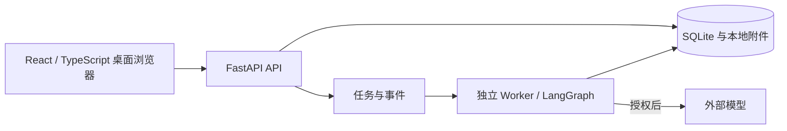

# CareerPilot

面向个人求职准备的本地 AI 工作台：导入目标岗位，结合能力证据规划学习，并将本人确认的成果用于简历和面试准备。

核心流程：**岗位 JD → 能力差距 → 学习计划 → 学习成果 → 简历草稿**。AI 辅助理解和生成建议；资料和计划写入需要用户确认，业务约束由程序校验。

## 功能与边界

- **AI 助手**：通过对话补充资料、查询进度、生成草稿和预览业务操作。写入前展示内容并等待确认；失败、拒绝和实际保存有不同反馈。
- **学习与求职**：分别管理学习计划、任务、练习、简历版本和申请记录；目标、岗位、资料及设置通过相关页面或辅助入口访问。
- **事实与版本**：个人自述、本人确认和客观能力证据分开处理；简历和申请引用事实及版本，来源变化需要重新核对。
- **受控执行**：计划预算、先修依赖和已完成或锁定任务由程序校验。任务回执、版本校验与幂等机制支持中断恢复和重复操作防护。

本项目默认是**单人、本机使用的桌面网页应用**，最小布局宽度 1100px；不代表已完成生产多租户部署。岗位资料主要由用户导入，申请草稿不会自动投递或发送邮件。外部渠道与真实模型能力只按已配置和实际验证的范围提供。题库包含参数化题目与经审校题目；参数化题量不等于同等数量的独立知识点。

## 架构



前端由 Vite 构建，FastAPI 同源提供页面与 API；Docker Compose 管理迁移、API、Worker 和隔离检查。SQLite 适用于当前单人本地、短事务的运行边界。模型负责理解和建议；资料来源、确认、状态和预算由领域服务执行。

## 启动

需要 Docker Desktop、Linux containers 和 Docker Compose。在项目根目录执行：

```powershell
docker compose build api
docker compose up -d --wait api worker
```

打开 [本地工作台](http://127.0.0.1:8000/app/)。首次启动执行数据库迁移，API 只发布到本机回环地址。日常停止使用 `docker compose down`，不要使用会删除业务卷的 `down -v`。

使用外部模型需要在本机 `.env` 配置 `DEEPSEEK_API_KEY`，并在设置中授权相应用途；密钥只传给 Worker。使用外部模型时，所需上下文会发送给模型服务商，因此本地部署不等于所有数据都不离开本机。无配置或授权时不能将模拟结果当作真实模型效果。

升级现有环境前应停止写入并备份整个数据根，包含业务数据库、工作流数据库和附件；恢复应先到独立目录验证。

## 验证与演示

```powershell
docker compose run --build --rm --no-deps checks
```

检查入口包含静态检查、自动化测试、评测和部分浏览器流程；具体执行情况以实际终端结果为准。测试截图、录屏、日志、报告和导出校验样本只在系统临时目录生成并清理，不保留验收证据包。

## 更多资料

- [资料填写指南](docs/PROFILE-WRITING-GUIDE.md)- [技术资料检索说明](docs/TECHNICAL-RAG.md)
