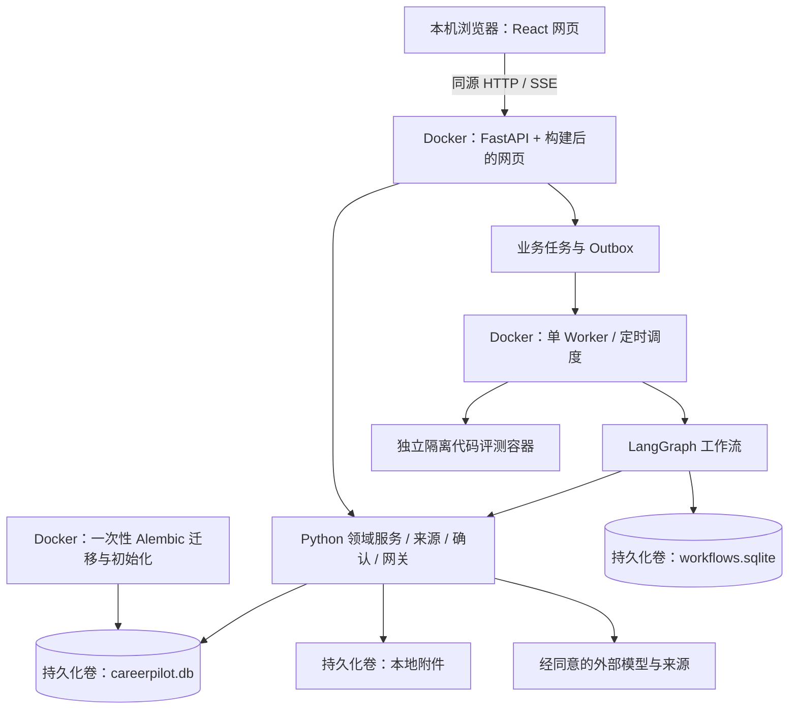

# CareerPilot 网页端技术栈重构实施规范

> 版本：v1.1 · 2026-10-27（Asia/Shanghai） 
> 状态：W-056 已在原项目实施 React/LangGraph 替换；原 /app/ 与业务卷保留，旧产品静态资源与旧 Agent 编排已退出。验证范围见 PLAN。 
> 使用方式：后续重构按本文技术边界、[TASKS §0](../TASKS.md) 的依赖和 [PLAN](../PLAN.md) 的实际状态推进。

## 1. 已确定的目标与范围

| 层级 | 确定技术 | 职责 |
| --- | --- | --- |
| 交互界面 | React + TypeScript + Vite | 浏览器中的聊天、侧栏、任务面板与业务页面 |
| 业务服务 | Python + FastAPI | HTTP API、资料与文件处理、确定性业务规则 |
| Agent | LangGraph；LangChain 按需引入 | 状态图、模型与工具编排、人工确认中断、工作流恢复 |
| 数据访问 | SQLAlchemy + Alembic | 领域持久化、事务、显式 Schema 迁移 |
| 存储 | SQLite + 本地文件夹 | 业务数据、持久化工作流状态、附件与业务备份 |
| 部署 | Docker + Docker Compose | 前端构建、迁移、API、Worker、检查与隔离评测的可复现运行环境 |

用户已取消 Electron，明确保留 Docker 部署。2026-10-27 用户取消手机尺寸适配，仅要求桌面浏览器布局，最小页面宽度为 1100px。最终提供本机浏览器网页入口，不开发桌面壳、preload/IPC、原生菜单、托盘、PyInstaller 或安装包；也不把本次重构扩展为公网服务。

产品沿用[功能收敛设计](PRODUCT-FOCUS.md)和 [PRD §0.4](../PRD.md)：单人本地、免登录、无注册/运营角色，5 个日常主入口为“今日行动、目标与岗位、学习与实践、求职、我的资料”，设置辅助放置。沿用 [ADR-028](ADR-028-local-personal-workspace.md) 的本地工作区归属和清空语义。

这是当前主技术栈的完整替换：React 接管保留范围的界面，LangGraph 接管 Agent 内部编排。领域规则、来源关系、资料和历史记录迁入新实现；不会以套一个 React 外壳或给旧 runtime 加一层 LangGraph 包装宣布完成。过渡入口和旧 Agent 执行分支在 R5 退出，最终只保留一套产品界面和一套 Agent 编排。

## 2. 文档优先关系与现状

当前产品范围由 PRD §0.4 和 PRODUCT-FOCUS 定义；技术决策见 [ADR-029](ADR-029-web-stack-docker.md) 与本文；工作项和依赖见 TASKS §0；实际执行结果只记入 PLAN。历史 V0～V4/CP 编号、原平台设计和旧桌面草案保留追踪，不覆盖当前决定。

W-055 规划时核对的旧栈基线（历史，当前实现见 [WEB-CONTRACTS](WEB-CONTRACTS.md)）：

- 后端已采用 Python/FastAPI、SQLAlchemy/Alembic；默认 Compose 已使用 SQLite，并非必须从 PostgreSQL 换库。
- 当前界面为 `src/careerpilot/static` 下的原生 JS/HTML/CSS；最新旧栈已实现免登录、5 项主导航、异步按钮反馈及工作区清空保护。
- `assistant.py` 与 `runtime.py` 采用自研阶段 checkpoint/租约运行；当前依赖尚未接入 LangGraph。
- Compose 已有 `migrate`、`api`、`worker`、`checks`，数据卷为 `careerpilot-data`，默认库在容器内 `/var/lib/careerpilot/careerpilot.db`。现行代码 Schema 为 `0006`，后续以执行时核对为准。
- 业务代码已有模型网关、工具约束、预算、来源、Outbox、幂等和历史版本；这些能力按业务职责保留，不因换框架丢失。

## 3. 最终运行结构

默认本地运行采用一个 API 和一个 Worker，不引入 Redis、微服务、独立向量库、云端 Agent Server 或 LangSmith 服务作为前置条件。API 和 Worker 共享领域服务代码和持久化存储，分别运行；长任务不依赖请求内协程、FastAPI BackgroundTasks 或浏览器连接存活。

### 3.1 Docker Compose 与启动顺序

| 服务 | 最终职责 | 数据与边界 |
| --- | --- | --- |
| `migrate` | 显式 Alembic 升级及兼容的非敏感种子初始化 | 成功后才允许 API/Worker 启动；不在每个请求内建表 |
| `api` | FastAPI、工作区解析、业务接口、SSE、React 构建资源 | 仅宿主回环地址发布网页/API 端口 |
| `worker` | 调度、派发、LangGraph 执行、取消/恢复、清理任务 | 无宿主公开端口；独立 heartbeat/就绪检查 |
| `frontend-dev` | 开发 profile 中的 Vite HMR 与 API 代理 | 仅开发启用，回环发布；不是日常构建版运行依赖 |
| `checks` | 前后端静态检查、领域/API/工作流/浏览器回归 | 隔离临时库，不挂载真实业务卷 |

保留 Compose 作为默认部署方式。日常构建版使用 Node 构建阶段产出网页，再将产物复制到 Python API 镜像；运行时不需要 Node/Vite 服务或宿主 Node/Python。前后端依赖分别锁定；具体兼容版本在 R0 核实后写入锁文件，不把旧 Python 镜像版本直接视为新依赖兼容验证。

构建需显式包含嵌套的 JS/CSS/字体资源，不能假定旧 `static/*` 包数据声明已覆盖新产物。日常构建版关闭 API 热重载；开发热重载与构建版配置分别验证。

开发使用 Compose 的 Vite 服务与 API/Worker，源码只挂载所需目录；写入依赖缓存或构建目录时使用受控开发卷，不改变真实数据卷权限。后端优先沿用现有迁移/健康检查/检查服务约定，具体命令在 R1 实现并验证后写入 README，本文不提供尚不存在的可执行命令。

默认挂载目录、端口和服务就绪契约在 R0/R1 明确；升级仍先停止写入、建立业务备份、运行迁移，再启动 API/Worker。禁止用 `docker compose down -v` 作为停止、重置或迁移手段。

### 3.2 浏览器与后台任务

- 打开网页直接进入本地工作区，不增加账号、用户令牌输入、运营角色或桌面进程握手流程。
- 关闭标签页或浏览器不取消任务；只要 API/Worker 容器运行，后台任务与站内提醒计算可继续。关闭电脑、停止 Docker 或 Worker 则不能继续执行；恢复后按任务和提醒规则处理到期项。
- 不承诺浏览器关闭时系统弹出通知；再次进入网页读取持久化任务与站内通知。浏览器订阅与任务取消是两个独立操作。
- 停止服务时停止接收新任务，执行有界退出并保存已提交状态。中断的运行依照 checkpoint/幂等回执恢复，结果未知的外部动作先核对，不盲目重试。

## 4. React 界面与接口规范

### 4.1 工程与界面职责

新增 `frontend/` 保存 React + TypeScript + Vite 源码；按 `app`（路由/布局）、`features`（业务）、`shared`（API/组件/双语）组织。Python 继续位于 `src/careerpilot`，逐步增加 `workflows/` 和明确的适配边界，不为换栈同时搬动全部领域模块。

React 负责表单、布局、聊天呈现和用户动作；Python 负责学习预算、证据状态、事实有效性、重要确认、来源和所有写入规则。前端展示状态来自真实业务结果，不因收到 HTTP 202 或动画结束而显示任务成功。

保留现有精简呈现：单页一个清晰标题、5 项主导航、上下文入口和必要空状态；不恢复重复口号、标签或平行资料表单。按中英、1280/1366/1440/1920px 桌面尺寸、键盘和可见焦点验证；按钮有处理中、成功或失败反馈，同页重试真正刷新，上传/下载的等待覆盖完整过程，取消旧请求不覆盖新响应。

### 4.2 URL、开发代理与构建版

- 保持 API 前缀 `/api/v1` 和健康入口 `/health/live`、`/health/ready`；优先适配当前接口，不为目录整理强制改写所有契约。
- 构建版网页统一在 `/app/` 提供，Vite `base` 与路由基路径一致。SPA 深链接刷新返回应用入口；缺失静态资源、API 错误和下载路径不能被 SPA fallback 吞成 HTML。旧 hash 路由逐项映射到新位置或历史资料入口。
- 构建版由 FastAPI 提供 React 产物，与 API 同源；Vite 是开发/构建工具，不使用 Vite 开发或 preview 服务承担日常部署。
- 开发浏览器访问 Vite，`/api`、`/health` 代理到 Compose 内 API；优先保持浏览器 Host/Origin 配对，后端显式核对受信本机开发入口。容器上游地址不同不构成关闭 Origin/Host/跨站检查的理由；不能设置任意 CORS 来源。
- 保持后端密钥只在服务端；供应商密钥、原始环境配置和私人正文不得编译进 `VITE_*`、前端资源或控制台。Vite 开发端口同样只绑定宿主回环。

Vite 支持后端集成与构建产物，FastAPI 支持静态资源挂载；上述路径、SPA fallback 和开发代理是本项目需实现并测试的约定，不能把简单 `StaticFiles(html=True)` 当作已完成所有深链接处理。[Vite 文档](https://vite.dev/guide/backend-integration)、[FastAPI 文档](https://fastapi.tiangolo.com/tutorial/static-files/)。

### 4.3 HTTP、流式事件与草稿

保留结构化错误的 `code/message/details/trace_id/retryable` 和现有版本冲突规则。前端 API 层统一处理语言、工作区上下文、错误和取消；TypeScript 类型根据实际 OpenAPI/契约生成或核对，类型断言不能代替运行时校验。

运行协议已在 W-056 实现，具体字段见 WEB-CONTRACTS，约束如下：

- 创建运行返回持久化 `run_id` 与状态，采用稳定幂等键；查询、事件订阅、取消、确认/恢复各有明确动作。当前入口位于 `/api/v1/workflows/runs` 下；实际字段、兼容投影与事件约定见 WEB-CONTRACTS。
- HTTP 接受命令，SSE 提供节点/工具进度、文本增量和最终状态，初期不同时维护另一套 WebSocket 协议。浏览器断线不作为取消条件。
- 持久事件携带 `run_id`、单调 `sequence`、事件类型和结构化负载；重连游标可重放已保留事件。逐 token 增量不要求全部入库，重连以已保存的消息快照补齐，不能宣称每个 token 都持久化。
- 游标过期时先同步当前快照；前端按运行及序号去重，并隔离旧订阅。流结束不等于任务完成；失败时保留已生成片段但明确失败，只有持久状态 completed 才显示成功。
- 工作区清空/更换后，旧标签页的写入和订阅不得污染新工作区；读取关联、导出、取消和恢复同样核对当前工作区上下文。
- 草稿绑定工作区、记录类型和编辑版本，支持保存状态、冲突比较与恢复。后端是已保存草稿的事实来源；服务断连时可用浏览器 IndexedDB 暂存未提交编辑，按工作区隔离、重置后清理，不存密钥或自动确认为事实。浏览器存储被清理前且已落本地缓存的输入可恢复，不能承诺所有隐私模式或磁盘故障均不丢输入。

## 5. LangGraph 替换与持久化

### 5.1 唯一编排边界

LangGraph 接管 Agent 的节点、分支、模型/工具调用、人工确认中断与恢复。LangChain 只在模型或工具适配确有需要时增加；保留现有供应商无关网关，不绕过配额、Schema 和授权。[LangGraph 官方说明](https://docs.langchain.com/oss/python/langgraph/overview)。

首条图：消息/上下文 → 识别意图/规划 → 工具与预算校验 → 读取或生成草案 → 必要时等待确认 → 调用领域命令 → 汇总实际结果。当前技能、学习、简历、申请等领域服务不复制到图节点中；规则任务可以保持确定性节点，不要求每一步调用模型。专家协作仍关闭。

原 `runtime.py` 中通用队列、租约、Outbox、幂等职责可整理保留，不能继续在其 Agent 分支中维护第二套内部步骤/checkpoint。订阅调度等非 Agent 任务不强制变成 LLM 图；Agent 执行的唯一恢复机制改为 LangGraph。

### 5.2 状态与一致性

- 工作流内部状态由持久化 checkpointer 管理；业务库保存运行索引、工作区、对话关联、图版本、派发租约和界面状态投影。业务事实仍保存于领域表。工作流状态与跨会话事实是不同职责。[持久化文档](https://docs.langchain.com/oss/python/langgraph/persistence)。
- 初期一个 Worker，限制同一运行并发。服务端生成稳定 `run_id`，对应唯一 LangGraph `thread_id`，对话 ID 单独关联；前端不能指定任意 thread 来读取其他历史或绕过工作区。
- 长模型/工具调用不持有数据库事务；执行期间续租/heartbeat 与取消检查须有明确机制，不能让原短租约超时后另一执行者重新领取仍在运行的图。
- 状态统一为 queued/running/waiting_confirmation/completed/failed/cancelled，图中断与 waiting_confirmation 明确对应。等待人工确认须落盘并释放执行租约和数据库事务，恢复命令再次核对工作区、版本和审批适用范围。
- 业务 SQLite 与 `workflows.sqlite` 不共享原子事务。节点写入使用以 run/动作/对象版本派生的稳定幂等键；Outbox 事务性记录派发，执行回执与启动对账处理“业务已提交、checkpoint 未保存”。LangGraph checkpoint 不等于外部动作恰好一次。
- 取消是持久化控制请求：停止后续步骤，不能撤回已提交的业务或已完成外部动作。重试/恢复不得以新键重复执行未知结果的动作，明确失败与结果未知的区别。
- 图版本和 state Schema 显式记录；不兼容升级须迁移或停止该运行并说明，不盲目续跑。切换前收口旧在途任务，不能映射的旧运行保留历史、明确中断，不能伪造 checkpoint 或自动重做。
- 消息、checkpoints、事件、草稿及附件纳入本地导出、清空、来源撤销和到期清理；先阻止旧运行恢复写入，再清理相关副本。业务备份依原规则保留，不随前端清空静默删除。

## 6. SQLite、文件与 Docker 数据保护

保留 `careerpilot-data` 及现有 `careerpilot.db`，工作流数据库与附件放在同一受控数据根目录的独立路径。构建产物、依赖缓存、源码与业务数据分开，容器替换不删除用户数据。不得把 SQLite 或附件仅写进容器可写层；也不把浏览器 localStorage/IndexedDB 当作主业务库。

- 先核对实际生效的数据库 URL、卷和附件配置；仓库旧 `data/careerpilot.db` 不能被当作最新库。不因换前端就复制、重建或重命名真实库；保持原 ID、来源和不可变快照。
- Alembic 是业务 Schema 变更入口；LangGraph checkpointer 的初始化/升级单独受版本约束，在服务就绪前完成。Schema 不兼容则停止就绪，不隐式重置数据。
- SQLite 使用外键、合理 busy_timeout、短事务；WAL 与实际镜像内 SQLite 版本在 R0/R3 验证，不能以“单人”假定没有 API/Worker 并发。初期不部署多个 API/Worker 共享 SQLite 以模拟 HA。
- 附件通过受控 ID/相对引用访问，校验类型/大小和路径，不接受网页输入的任意服务器路径；浏览器以文件选择上传，以下载响应导出。私有附件目录不得作为无需校验的静态目录公开。
- 一致备份必须覆盖业务库、工作流库和附件：暂停新写入并等待/安全中断运行，使用 SQLite backup 等一致性机制，记录相互对应的业务版本并校验引用后恢复。不能仅复制活动 `.db` 主文件忽略 WAL。
- 迁移采用先备份、后升级、失败停止与恢复；恢复先在隔离新卷/目录验证，再受控切换。禁止覆盖已有目标库或通过删卷绕过冲突；旧程序不直接运行于不兼容的新 Schema。
- 保留现有 PDF/Word 后端导出能力及容器内所需 Chromium/中文字体，不采用 Electron 打印。OCR/视频/语音等延期能力不因本次重构自动恢复到主流程；其旧私人文件仍可读取/导出/删除。
- 代码隔离评测继续使用独立容器及现有适配边界。评测容器不共享 API/Worker 的业务卷、密钥、网络或宿主命令能力；不得为方便网页启动而把 Docker socket 暴露给浏览器/API，具体受控执行通道在 R4 核对验证，不能用宿主 Python 直接执行用户代码。

## 7. 实施顺序、阶段出口与旧栈退场

| 阶段 | 工作范围 | 阶段出口 |
| --- | --- | --- |
| R0 基线与契约 | 保留/合并/延期及旧页面/API/记录映射；资料草稿/引用契约；运行/事件/错误协议；Docker 构建依赖方案 | 所有保留能力和旧私人资料有归属，接口与状态边界可供实现；版本/依赖方案可复现，无桌面打包工作项 |
| R1 Web + Compose 底座 | React/TS/Vite 工程、类型化 API；Node 构建阶段；FastAPI 网页资源；开发代理/健康和一次性迁移 | Compose 可启动构建版，刷新深链接/静态资源/API 错误正确；开发 HMR 与本地同源约束通过；容器重建数据不丢失 |
| R2 React 业务迁移 | 按 5 入口重建；聊天/任务、分步资料、草稿/去重、事实到简历/面试复用 | 保留业务入口可用，中英/键盘/1280/1366/1440/1920px 桌面尺寸 与等待/错误反馈通过；不复制第二套档案或项目事实 |
| R3 LangGraph 接管 | 图/受控工具/网关、SQLite checkpointer、派发、人工确认、取消/重试、SSE/快照恢复 | 真实持久状态与投影一致；断线/Worker 重启/重复命令不重复写入；旧 Agent 内部编排退出 |
| R4 数据与本地能力 | Docker 卷/附件、导出/清空、版本迁移/备份恢复、独立代码评测、延期旧数据管理 | 原资料关系和历史保持；备份可在隔离卷恢复；工作区清空后旧运行/标签页不能复写；导出与隔离边界通过 |
| R5 最终切换 | 两条主业务链、构建/升级/失败恢复；关闭旧静态产品入口和过渡适配；同步运行文档与检查 | 默认只有 React 网页及 LangGraph Agent，保留 Compose 部署；无 Electron/旧界面/旧 Agent 双轨；按当前产品范围完成回归 |

每个阶段的工作项、前置和状态统一维护在 TASKS §0；可以在接口明确后交错实施，最终切换必须等待依赖出口通过。R0 细化后再估算工期，不将历史任务数量或“601 passed”等旧实现结果换算成新栈进度。

临时新旧界面可用于逐模块验证，但不能双写或同时执行同一运行。R5 删除的是已替换的旧产品入口与 Agent 执行路径，领域模块、历史回归合同和必要数据迁移仍保留。旧版本代码由 Git 保存；回退数据使用已核对的备份/兼容迁移，不把启动旧镜像视为完整回退。

## 8. 验证与后续工作入口

后续验证覆盖领域规则与 API 合同、React 行为和双语无障碍、LangGraph 状态恢复及幂等、SSE 重连、Docker 构建/启动/迁移、SQLite/附件一致恢复、工作区清空保护、PDF/Word 和独立隔离评测。成长链与求职链均使用隔离临时数据，真实供应商联调、模型费用和模拟结果分别记录，不从离线样例推断已验证外部效果。

遵守 AGENTS.md：测试截图、录屏、日志、报告、导出样本及验收检查产物仅在系统临时上下文生成、查看并清理，成功/失败均清理；不建立持久化验收证据包。本文的设计与阶段完成条件属于实施规范，不记录执行明细或导出测试清单。真实业务来源、数据库和业务备份按业务规则保留。

下一轮先完成 R0-T1/R0-F1 的现状与功能数据映射，再落实 R0-F2 资料契约、R0-T2 运行/事件契约和 R0-T3 Docker 构建方案，随后进入 R1。本文不表示已建立 React 工程、接入 LangGraph、构建镜像或执行真实数据迁移。
